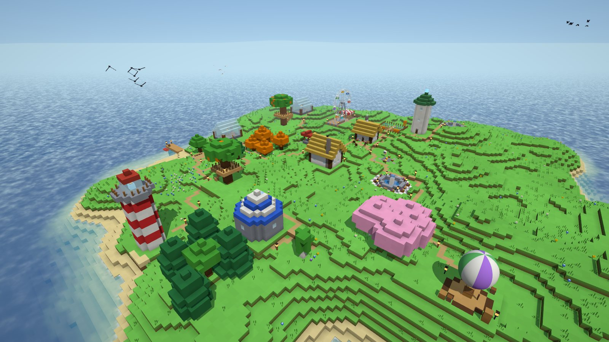
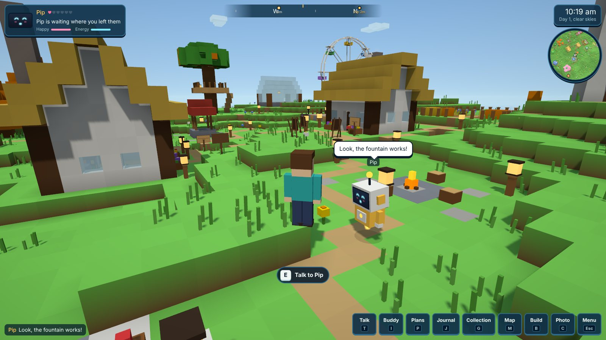
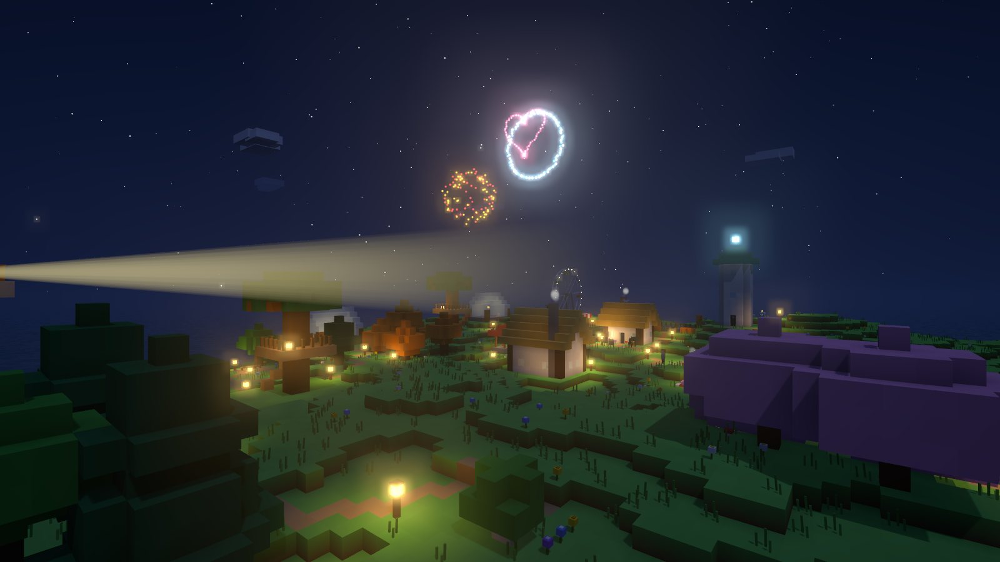

# Buddy Isle

A little block island in your browser, built by an AI best friend who keeps building while you're away.



You start on an empty island. Your buddy, a small hovering robot with a screen for a face, starts building: a campfire first, then a cottage for itself, then a furnished house for you. After that it decides for itself: towers, gardens, ponds, groves, a windmill, a lighthouse, a fountain plaza, a gazebo, a Ferris wheel, a hot-air balloon, an observatory, piers with rowboats, statues, ground mosaics, a treehouse. It paints pictures and hangs them up, lays lantern-lit paths between everything, and when the island fills up it raises new little islands out of the sea and builds bridges to them.

Close the tab, come back later, and there's a letter waiting telling you what it did, what the weather was like and whether it left you a present.





## What's in it

**A living island**
- Day and night, glowing lanterns and lit windows after dark, sunsets, stars, shooting stars and the real phase of the moon.
- Weather that follows a schedule on the real clock: sun, clouds, rain (with thunder), mist, snow in winter, and rainbows after rain.
- Seasons that follow your calendar: autumn leaves, winter snow on the rooftops, spring colours. You can also pick one.
- Waves, shore foam and clear shallow water. Plants and leaves sway in the wind.
- Birds and seagulls, butterflies, fireflies, fish jumping out of the sea, and chickens, cats, ducks and bunnies that move in when the buddy builds gardens, houses, ponds and groves.
- Saplings that grow into trees and wheat that ripens over real hours, even while you're away.
- Generated music and a full nature soundscape (waves, wind, rain, birds, crickets, crackling fires).

**Your buddy**
- Builds on its own, block by block, with a see-through hologram of what it's about to build.
- Has moods: happiness and energy go up and down with what happens. It gets sleepy at night and goes to bed in its cottage.
- Becomes closer friends with you over time (six friendship levels). Hanging out, chatting, petting it and opening its presents all count.
- Has a plans board: three ideas it wants to build next, with its reasons. Push one to the front or say no, and it remembers.
- Paints, fishes, plays music in the gazebo at night, sets off fireworks for celebrations, leaves notes and presents.
- Its eyes follow you, and its face changes with its mood.

**Things you can do**
- **E** to interact: talk to your buddy (pet it, high-five it, ask it to follow you or hang out, make it dance), pet animals, sit on benches and stumps (your buddy comes and sits with you), sleep in your bed to skip to morning, open presents, read notes, look at paintings.
- Ride the Ferris wheel, take the hot-air balloon on a tour around the island, and row the boat out to sea.
- Fish anywhere there's water and fill in a collection of 17 species. Some only bite at night, in ponds, or in the rain.
- Look at the stars through the observatory telescope.
- Take photos (C) and keep them in your collection.
- Choose exactly where something gets built: pick it from the catalog (P), aim at the ground, and a green or red preview shows if it fits.
- Build with blocks yourself (B), including furniture. Your buddy won't build over your stuff.

**Worlds and saves**
- As many worlds as you want, each with its own island, buddy name, colour and personality.
- Export a world to a file to back it up or move it to another computer.
- Optional real AI brain for conversation (Claude, or a local model through Ollama / LM Studio). Without it, the built-in brain still builds, paints and understands lots of requests.
- No accounts, no server, no build step. Saves stay in your browser.

## Put it on GitHub (and play it from anywhere)

1. Create a new repository on GitHub, for example `buddy-isle`.
2. Upload everything in this folder to it. Either drag the files into the GitHub web page ("Add file" > "Upload files"), or from a terminal:
   ```bash
   cd buddy-isle
   git init
   git add .
   git commit -m "Buddy Isle"
   git branch -M main
   git remote add origin https://github.com/YOUR-NAME/buddy-isle.git
   git push -u origin main
   ```
3. In the repository, open **Settings > Pages**. Under "Build and deployment", set **Source** to "Deploy from a branch", pick **main** and **/ (root)**, and press **Save**.
4. After a minute your island is live at `https://YOUR-NAME.github.io/buddy-isle/`.

## Run it on your own computer

The game uses JavaScript modules, so it has to be opened through a small web server rather than by double-clicking `index.html`. Any of these work from inside the folder:

```bash
python3 -m http.server 8000      # then open http://localhost:8000
npx serve .                      # if you have Node.js
```

Handy switches you can add to the address:

| Add this | What it does |
| --- | --- |
| `?fast` | Your buddy works eight times faster |
| `?weather=rain` | Force the weather (`clear`, `cloudy`, `rain`, `mist`, `snow`, `rainbow`) |
| `?season=winter` | Force a season (`spring`, `summer`, `autumn`, `winter`) |
| `?time=0.9` | Start at a time of day (0 = midnight, 0.5 = noon, 0.75 = sunset) |

You can combine them: `?fast&weather=snow&season=winter`.

## Controls

| Key | What it does |
| --- | --- |
| W A S D | Walk (or row the boat) |
| Space | Jump (and swim up) |
| Shift | Run |
| Mouse | Look around. Click the world to capture the mouse, Esc lets go. You can also drag. |
| Wheel | Zoom the camera |
| V | First person view |
| E | Use whatever you're next to: your buddy, animals, seats, beds, presents, rides, water (fishing), the telescope |
| T or Enter | Chat with your buddy |
| F | Your buddy follows you (press again to let it go) |
| P | Your buddy's plans, and the catalog for choosing where to build things (R turns the preview) |
| I | About your buddy: mood, friendship, personality, what it remembers about you |
| B | Build mode: left click removes a block, right click places one, Q/E, the wheel or 1–9 pick the block |
| C | Photo mode |
| J / G / M | Journal / Collection (paintings, photos, fish, keepsakes) / Map |
| H | All controls |
| Esc | Menu and settings |

On a phone or tablet, the left thumb stick walks, dragging on the right looks around, and there are buttons for jumping, talking and using things.

## Things to say to your buddy

- "build a Ferris wheel", "plant some trees near me", "make a pond", "build a lighthouse", "make a new island"
- "paint a sunset", "paint me", "paint yourself", "paint the windmill"
- "dance", "fireworks" (at night), "go fishing", "play some music", "go to sleep"
- "follow me", "stay here", "hang out", "come here", "go have fun"
- "what are your plans?", "how do you feel?", "are we friends?", "what did you do while I was gone?"
- "show me the gallery" (takes you there)
- "I like pumpkins", "my favourite colour is blue" (it remembers, and builds more of what you like)
- "tell me a joke"

## How "while you're away" works

A web page can't run when its tab is closed, so nothing happens on a server while you're gone. Instead, when you open your world again, the game works out how long you were away and lets your buddy catch up: it plans and builds one thing for every stretch of time you were gone, each stamped with the time it would have happened. Saplings and crops grow on the real clock, and the weather follows a fixed schedule, so the letter can tell you it rained. It's the same if you leave the tab in the background.

| Pace | While you're away | While you watch |
| --- | --- | --- |
| Chill | 1 or 2 things an hour, up to 10 per visit | slow and relaxed |
| Normal | 2 or 3 things an hour, up to 20 per visit | a new build every few minutes |
| Busy | about 6 things an hour, up to 40 per visit | barely stops |

## Graphics settings

Open the menu (Esc) and pick a graphics preset:

- **Fancy**: glow on lights and fireworks, sharp shadows, the most animals.
- **Balanced** (default): glow and shadows at a lighter cost.
- **Fast**: no glow or shadows, fewer animals. For older computers, laptops, phones and tablets (phones and tablets start on this one). If the game notices it's running slowly, it offers to switch for you.

You can also turn the mini map and compass on or off, and set music, nature sounds and effects volumes separately.

## Optional: give your buddy a real AI brain

Open the menu (Esc) and find **AI brain**.

- **Claude:** paste an API key from [console.anthropic.com](https://console.anthropic.com). The default model is `claude-haiku-5-5`, which is fast and cheap; a chatty evening costs a few cents at most. You can type a different model name if you want.
- **Other / local:** any OpenAI-style server. For [Ollama](https://ollama.com) on your own computer, start it with `OLLAMA_ORIGINS="*" ollama serve`, use the server URL `http://localhost:11434/v1` and a model you've pulled (for example `llama3.2`). Some browsers won't let a page on github.io talk to your own computer; if that happens, run the game locally too (see above).

With an AI brain, your buddy knows its mood, the weather, its plans and what it has built, and can act on what you say: build, paint, dance, set off fireworks, give you a present, remember things about you. You can also let it write journal entries and the reasons for its ideas in its own words (a small, rate-limited extra).

Your key is stored only in your browser and is only sent to the service you pick. The building itself always uses the built-in brain, so your island keeps growing with or without a key.

## Saves

Worlds are saved in your browser (IndexedDB) automatically every 15 seconds and whenever you leave. Photos are stored separately so saving stays fast. That means:

- Each browser and device has its own saves. Use **Export world** / **Import a world** to move one. (Photos aren't included in exports; download the ones you want to keep.)
- Clearing your browser's site data for the page deletes the saves. Export anything you care about first.
- Worlds from the first version of Buddy Isle open fine and get all the new features.

## Make it yours

Everything is plain JavaScript with no build step, so you can edit a file and refresh.

| File | What's in it |
| --- | --- |
| `src/buddy/blueprints.js` | Every kind of thing the buddy can build, and the catalog text. Copy one and change it to add your own. |
| `src/buddy/brain.js` | How the buddy decides what to do: ideas, moods, friendship, sleeping, gifts, fireworks. |
| `src/buddy/voice.js` | Everything the buddy says, per personality, painting titles and idea reasons. |
| `src/buddy/chat.js` | What the built-in brain understands when you talk to it. |
| `src/buddy/collect.js` | The fish you can catch and the presents your buddy gives. |
| `src/buddy/face.js` | The buddy's screen face and expressions. |
| `src/buddy/llm.js` | The optional AI brain (prompt and providers). |
| `src/buddy/offline.js` | The "while you were away" catch-up and the letter. |
| `src/world/` | Terrain, blocks, meshing, sky, ocean, weather, animals, growing plants, props and rides. |
| `src/render/` | Shaders for lantern light, wind and seasons, particles, and the glow effect. |
| `src/player/` | Walking, camera, interacting, fishing, choosing where to build, build mode, touch controls. |
| `src/ui/` | Title screen, HUD, compass, mini map, panels and building pictures. |
| `src/core/audio.js` | All the music and sounds (generated live, no audio files). |

To add a new building, add an entry to `BLUEPRINTS` in `blueprints.js` with a `size`, `name`, `build` and `story`, add it to `CATALOG` in the same file, then give it a weight in `buildWeights()` in `brain.js`, a reason in `IDEA_REASONS` in `voice.js`, and a keyword in `chat.js` so you can ask for it.

## Credits

- 3D rendering by [three.js](https://threejs.org) (MIT), included in `src/vendor/`.
- Fonts: [Pixelify Sans](https://fonts.google.com/specimen/Pixelify+Sans) and [Atkinson Hyperlegible](https://fonts.google.com/specimen/Atkinson+Hyperlegible) from Google Fonts (SIL Open Font License).
- Everything else in this repository is MIT licensed. See `LICENSE`.

A Zyper Cyber project.
